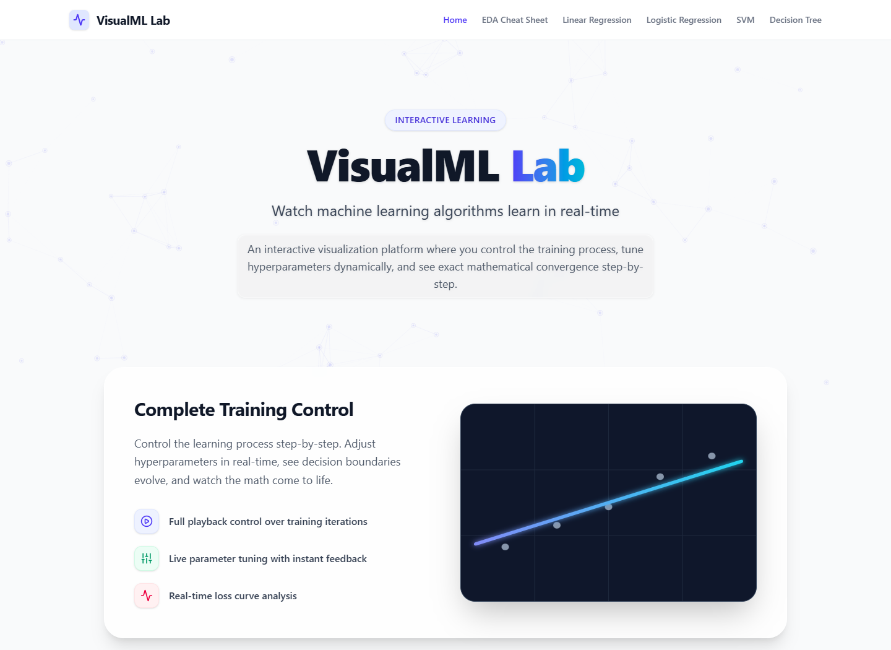
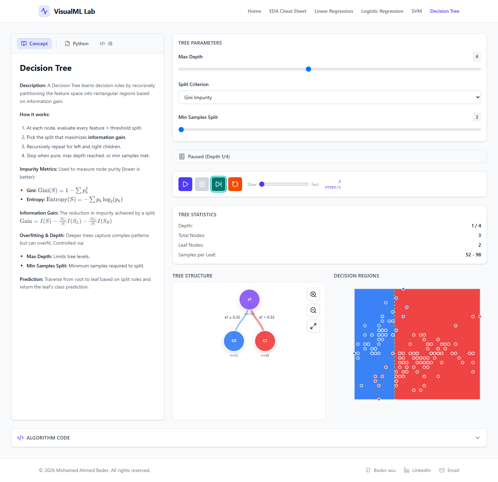
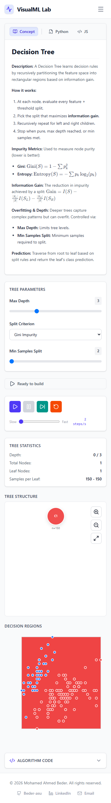
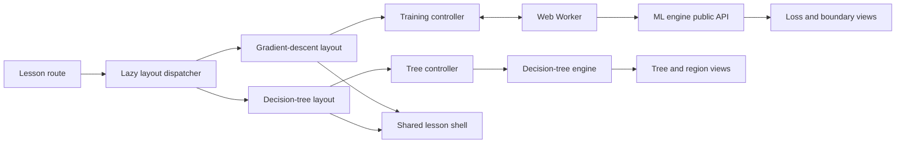

# VisualML Lab

An interactive, browser-based environment for exploring how machine-learning algorithms learn.

[](https://github.com/Beder-asu/VisualML-Lab/actions/workflows/ci.yml)

[Open the live application](https://mllab-one.vercel.app) · [Explore the EDA cheat sheet](https://mllab-one.vercel.app/eda-cheatsheet)





<details>
<summary>Mobile Decision Tree view</summary>



</details>

## Why this project exists

Most introductory machine-learning material shows an equation, a finished chart, or a library call. That leaves the training process itself largely invisible.

VisualML Lab turns that process into something learners can control. Users can advance an algorithm one step at a time, change its parameters, inspect the resulting loss or decision boundary, and compare the visualization with Python and JavaScript implementations.

The project is both an educational product and an engineering experiment in keeping numerical code, interactive rendering, and explanatory content understandable as the number of lessons grows.

## What you can explore

| Lesson | What the visualization exposes | Adjustable inputs |
| --- | --- | --- |
| Linear Regression | The fitted line and loss as gradient descent updates the model | Learning rate, iteration limit, dataset |
| Logistic Regression | A classification boundary, predictions, and convergence behavior | Learning rate, iteration limit, dataset |
| Support Vector Machine | The evolving linear decision boundary and hinge-loss training | Learning rate, regularization, iteration limit, dataset |
| Decision Tree | Level-by-level tree growth alongside the corresponding 2D decision regions | Maximum depth, Gini or entropy criterion, minimum samples per split |

Across the lessons, users can:

- play, pause, step, and reset training;
- tune parameters and see their effect immediately;
- inspect loss history, model state, and decision regions;
- use keyboard shortcuts for repeated experiments;
- read the concept explanation and switch between Python and JavaScript examples; and
- explore a searchable EDA reference covering 14 visualization types and when to avoid each one.

All datasets and computations run in the browser. The deployed application does not require an API or user account.

## Engineering approach



The implementation separates four concerns:

1. **Numerical engine** — algorithm steps, datasets, validation, serialization, and decision-boundary calculations live outside React.
2. **Execution control** — iterative regression and SVM steps run through a Web Worker so repeated computation does not block the interface. Decision Tree currently uses a dedicated step-based controller on the main thread.
3. **Lesson layouts** — a lazy dispatcher selects either the shared gradient-descent layout or the tree-specific dual visualization.
4. **Presentation** — `BaseLayout` owns the common concept panel, controls, code panel, keyboard behavior, help, and error states.

This boundary is intentional: UI code consumes the integrated engine rather than importing experimental implementations from `port/`. Random Forest and XGBoost files in that directory are staging work, not shipped lessons.

## Design decisions worth noting

- **Step-based execution:** every lesson supports deliberate inspection instead of only showing a final fitted model.
- **Worker isolation:** gradient-based training crosses a serializable worker boundary, keeping rendering responsive.
- **Different models, different views:** Decision Tree has its own layout because a hierarchy and rectangular regions cannot be explained well by reusing a loss-chart layout.
- **Deterministic embedded datasets:** lessons are repeatable and require no runtime data download.
- **Progressive loading:** lesson families and the EDA reference are split from the initial bundle.
- **Defensive deployment headers:** Vercel applies a Content Security Policy, frame denial, MIME sniffing protection, and a strict-origin referrer policy.

Additional rationale is recorded in [ARCHITECTURE_DECISIONS.md](./ARCHITECTURE_DECISIONS.md).

## Verification

Verified on 2026-10-18:

| Check | Result |
| --- | --- |
| Engine unit and property tests | 81 passing |
| React component, hook, integration, accessibility, and property tests | 408 passing |
| Browser smoke test | Passing in Chromium: open Decision Tree, change maximum depth, step once, and verify both visualizations update |
| Production TypeScript and Vite build | Passing |
| Continuous integration | Engine tests, UI tests, Chromium smoke test, and production build on every push and pull request |
| Live Decision Tree interaction | Verified: stepping changes the tree depth, node count, and decision regions |
| Responsive browser audit | Homepage and Decision Tree verified at 390px with no horizontal overflow |
| Production dependency audit | No critical, high, or moderate advisories; four low-severity KaTeX-chain advisories remain pending a tested major upgrade |

The UI test configuration isolates modules between files so component mocks cannot leak across suites. A previous wall-clock “performance” assertion was removed because it measured jsdom and supplied a one-node fixture while claiming to represent 255 nodes; it was not defensible evidence of browser performance.

## Current limits

- The project teaches four algorithms; the staged ensemble implementations are not yet integrated.
- Visualizations use small, embedded 2D datasets for clarity, not large-scale model training.
- The Decision Tree controller still computes on the main thread, unlike the worker-backed gradient lessons.
- The browser suite currently covers one critical Decision Tree path; it is a smoke test rather than exhaustive end-to-end coverage.
- KaTeX requires a major-version upgrade to clear the remaining low-severity dependency advisories; that upgrade should be tested rather than forced.

## Technology

- React 19 and TypeScript
- Vite and Tailwind CSS
- D3 hierarchy utilities and SVG/canvas rendering
- Web Workers
- React Router
- React Markdown and KaTeX
- Vitest, React Testing Library, and fast-check

## Run locally

Prerequisites: a current Node.js release and npm.

```bash
git clone https://github.com/Beder-asu/VisualML-Lab.git
cd VisualML-Lab
npm install
npm run dev
```

Then open `http://localhost:5173`.

## Validate changes

```bash
npm test
npm run test:ui
npm run test:e2e
npm run build
```

## Repository map

```text
engine/                    Integrated ML engine and worker
port/                      Experimental algorithm ports; not product features
src/components/            Shared controls and visualizations
src/hooks/                 Training, worker, keyboard, and tree controllers
src/pages/layouts/         Algorithm-family lesson layouts
src/data/                  Lesson and EDA reference content
docs/                      Layout extension and API guides
e2e/                       Playwright browser smoke tests
output/playwright/         Verified README screenshots
```

To add a lesson, start with [the layout extension guide](./docs/ADDING_NEW_LAYOUTS.md). The shared shell is documented in [the BaseLayout API reference](./docs/BASELAYOUT_API.md).
