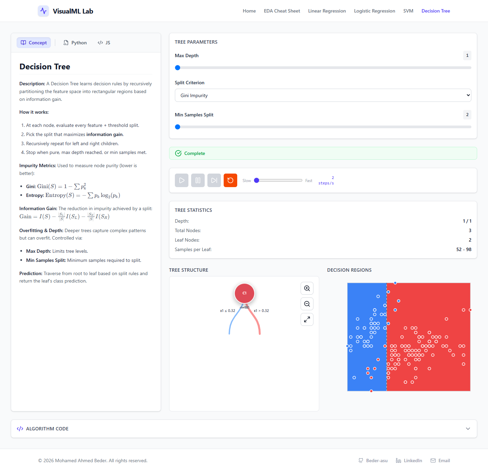
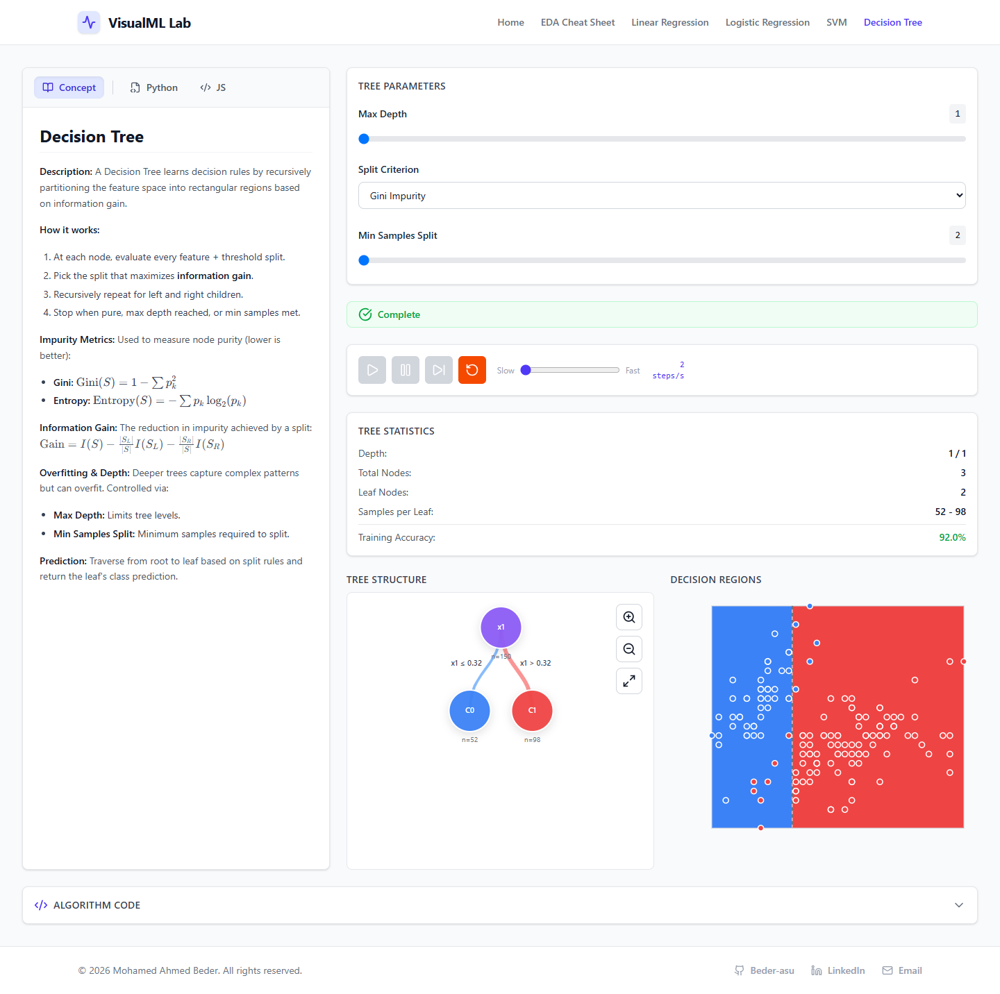
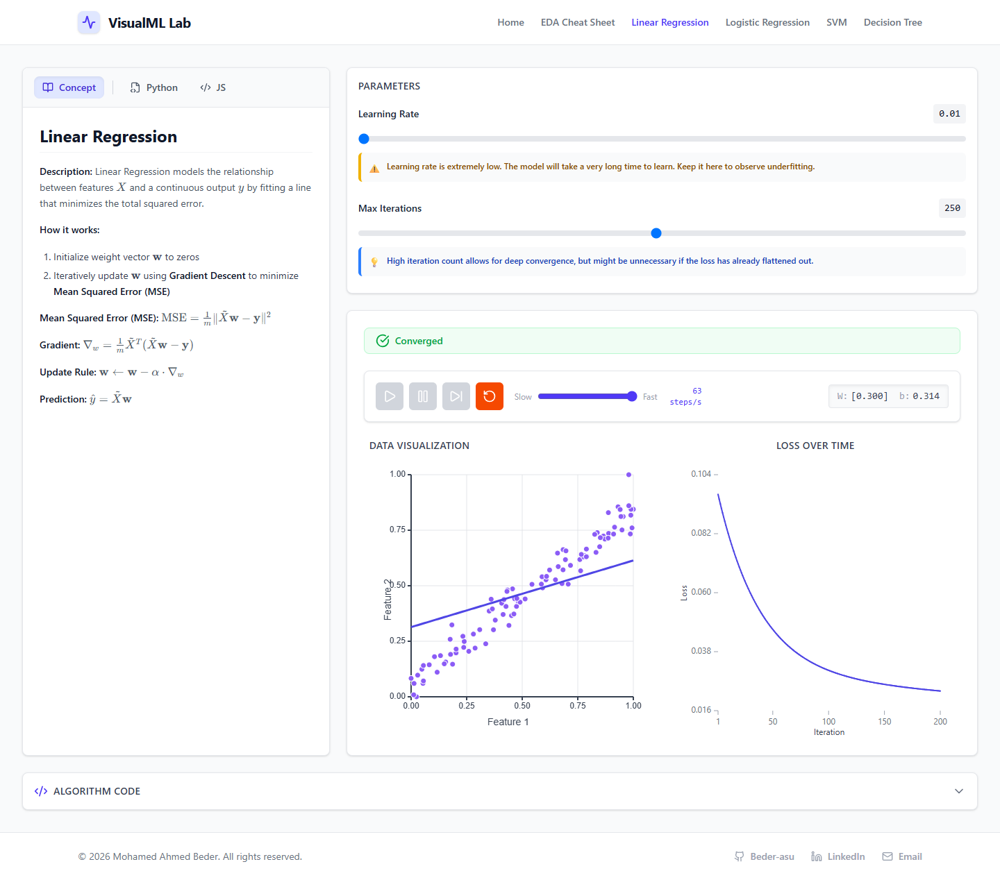
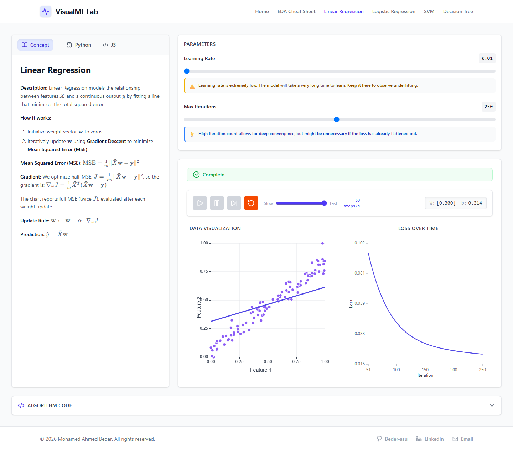

# Functional review fixes and retained verification

Date: November 6, 2026. Baseline: `3354c53`. Branch: `codex/functional-review-fixes`.

This change addresses the seven confirmed non-onboarding functional findings, native worker failure recovery, and numerical explanation/loss consistency. Tutorial entry points, steps, and lifecycle are intentionally unchanged. Broader product, architecture, SEO, and visual-redesign recommendations are outside this change.

## Corrected behavior

| Review item | Result | Retained verification |
|---|---|---|
| CR-01: concurrent manual steps | Accepted steps are queued and dispatched from the latest worker result. Pause cancels queued work; an in-flight result may still commit. Reset, dataset/parameter changes, errors, and unmount clear queued/scheduled work. | `useTrainingController.queue.test.ts`: delayed real-engine responses, sequential iterations, cancellation, iteration ceiling, and scheduling. |
| CR-02: rolling loss labels | A retained 200-point history at iteration 250 is labeled 51–250. Accessible descriptions identify the first retained observation rather than the initial session loss. Single-point ticks are valid. | `LossCurve.test.tsx` and a 250-step real-worker browser test. |
| CR-03: tree accuracy at maximum depth | Statistics use the same completion condition as the controller: engine completion or reaching the selected maximum depth. | Real-engine integration at depths 1 and 3; browser verifies depth-1 accuracy of 138/150 = 92.0%. |
| CR-04: live tree speed | Changing the speed replaces the running interval while preserving tree progress. | Fake-clock integration checks new scheduling, single interval, Pause, and unmount. |
| CR-05: keyboard ownership | Handled tree navigation keys no longer trigger global training actions. Native form-control Space behavior is preserved; help dialogs suspend lesson shortcuts. Existing tree items are exposed to the accessibility tree. | Shortcut tests, affected tree/layout tests, and browser keyboard/role assertions. |
| CR-06: interrupted animation | New boundary targets interpolate from currently displayed geometry. Unchanged geometry does not cancel an active animation; reset/unmount cancel obsolete frames. | Deterministic RAF/performance-clock regression tests. |
| CR-07: resized region cache | Offscreen dimensions and cached geometry are invalidated on size/content changes. Drawing and hit-testing scales remain aligned. | Cache resize/content tests and a mobile-to-desktop browser pixel-alpha check on the expanded plotting area. |
| Native worker failures | Native runtime/deserialization and synchronous post failures report errors with the active generation. A subsequent request can create a replacement worker. | Native event and synchronous error tests in `useEngineWorker.test.ts`. |
| Numerical consistency | Linear/logistic loss is evaluated at returned weights, matching SVM's existing timing. Linear updates retain half-MSE scaling; the explanation distinguishes this objective from the full-MSE chart. Completion wording no longer claims mathematical convergence from an iteration limit alone. | Independent first-update/loss examples and finite-difference gradient checks in `numerical-reference.test.js`; status tests. |

## Before and after browser references

The baseline production build was captured before application edits. The fixed production build uses the same viewports and sample interactions. These screenshots are functional references, not pixel-perfect golden tests; transition timing may differ between captures.

| Observation | Before | After |
|---|---|---|
| Maximum-depth tree accuracy | Hidden despite completed status | Visible: 92.0% at depth 1 |
| Right Arrow in the initial tree | Advances training to 3 nodes at depth 1 | Remains at 1 node/depth 0 while navigating |
| Retained history after 250 steps | Tick endpoints 1 and 200 | Tick endpoints 51 and 250 |
| First retained loss description | Described as initial loss | Explicitly identifies retained iterations 51–250 |

### Tree completion

Before:



After:



### Loss history

Before:



After:



Mobile references: [tree before](../output/playwright/functional-review/before/tree-resized-mobile.png), [tree after](../output/playwright/functional-review/after/tree-resized-mobile.png), [linear before](../output/playwright/functional-review/before/linear-250-mobile.png), [linear after](../output/playwright/functional-review/after/linear-250-mobile.png).

Machine-readable observations: [before](../output/playwright/functional-review/before/observations.json), [after](../output/playwright/functional-review/after/observations.json).

## Run the retained tests

```bash
npm ci
npm test -- --maxWorkers=2
npm run test:ui -- --maxWorkers=2
npx playwright install chromium
npm run test:e2e -- --workers=1
```

`test:e2e` builds the application and exercises the production preview, including the existing smoke test and the new browser regressions. The browser runner starts the preview automatically when one is not already running. CI retains engine/UI tests and browser verification; concurrency is bounded to reduce test-worker contention.

On a machine with installed Chrome instead of Playwright Chromium, set `PLAYWRIGHT_CHANNEL=chrome` for the browser command. On this Windows workstation, focused and full UI tests used `--pool=threads --maxWorkers=1` after fork-worker startup timeouts. Test thresholds and assertions were not relaxed to conceal those failures.

To capture references, start a production preview at port 4173, then run:

```bash
node scripts/capture-functional-reference.mjs after
```

The reference script uses installed Chrome, records desktop/mobile screenshots, and asserts the corrected observations for `after`. Use `before` only against an unfixed baseline build; do not regenerate the baseline from fixed source.

## Verification and limits

- Engine suite: 85 tests passed in 10 files.
- UI suite: 431 tests passed in 35 files.
- Production TypeScript/Vite build passed.
- Production-browser suite: all 8 tests passed in installed Chrome on Windows.
- Browser coverage includes real bundled workers for Linear Regression, Logistic Regression, and SVM; reset/completion; rolling loss history; tree accuracy; keyboard ownership; and resize rendering.
- Browser checks were performed in installed Chrome on Windows. No claim of Firefox, WebKit, physical-device, deployed-CSP, or comprehensive accessibility certification is made.
- Existing Vite chunk-size/native-config warnings and jsdom canvas-context warnings remain. Actual canvas behavior is additionally checked in the browser.
- This work does not address onboarding or unrelated limitations listed in the earlier report.
